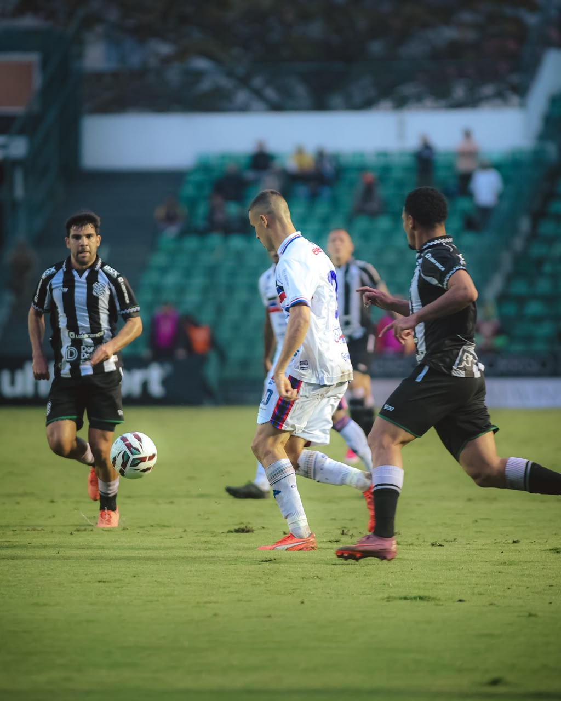

O meio campista de 28 anos continuará no clube, onde disputou 31 jogos, marcou 3 gols e 2 assistências na temporada 2026. 

Desde 2022 no clube, o goleiro de 26 anos renova por mais uma temporada com o Maranhão. Em 2026, o atleta disputou 5 jogos com a camisa Quadricolor.

.jpeg "Iury Oliveira / MAC")
