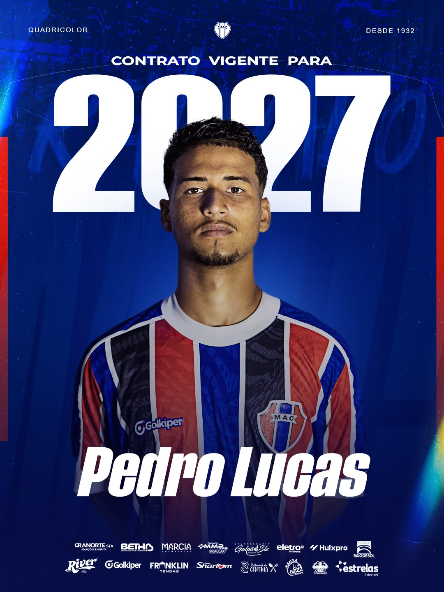
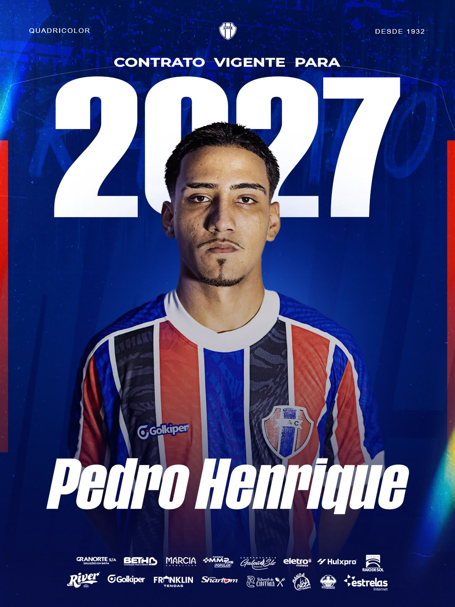

O Maranhão Atlético anuncia que os atletas Almeida, Pedro Lucas e Pedro Henrique, que tem contrato em vigência com o clube até 2027, estarão no elenco do bode para a próxima temporada. 

Zagueiro Almeida de 20 anos, volante Pedro Henrique de 19 anos e o meia atacante Pedro Lucas de 21 anos subiram recentemente da base quadricolor e estarão no elenco principal em 2027

