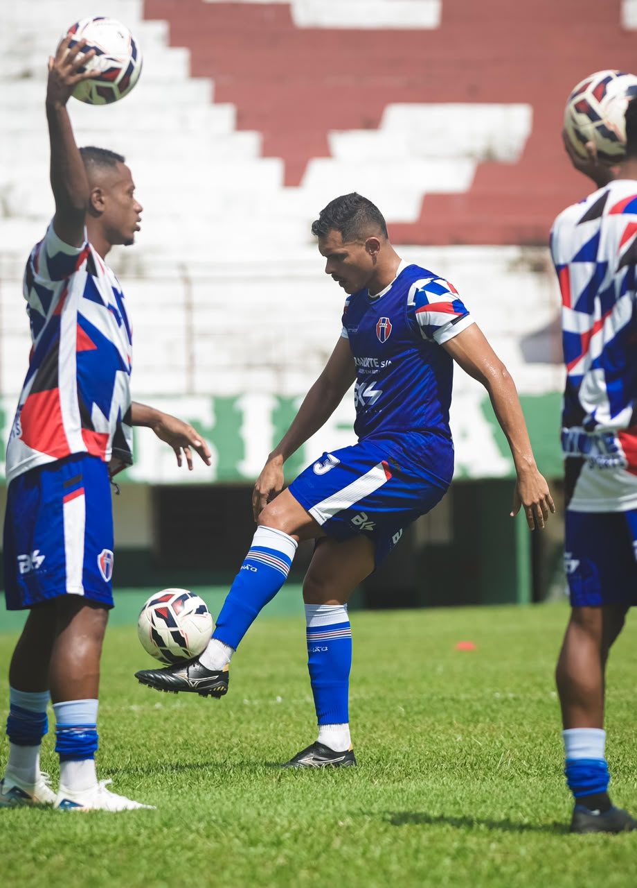

O Maranhão anuncia a contratação do zagueiro Júlio Nascimento para a temporada 2027. 

O defensor de 31 anos retorna ao clube onde foi campeão maranhense em 2025 e obteve o acesso para o Brasileirão Série C. 

Em 2026, o atleta iniciou a temporada no Maranhão mas se transferiu para o Serra Branca-PB e passou pelo Sousa-PB e Pelotas-RS neste ano.

