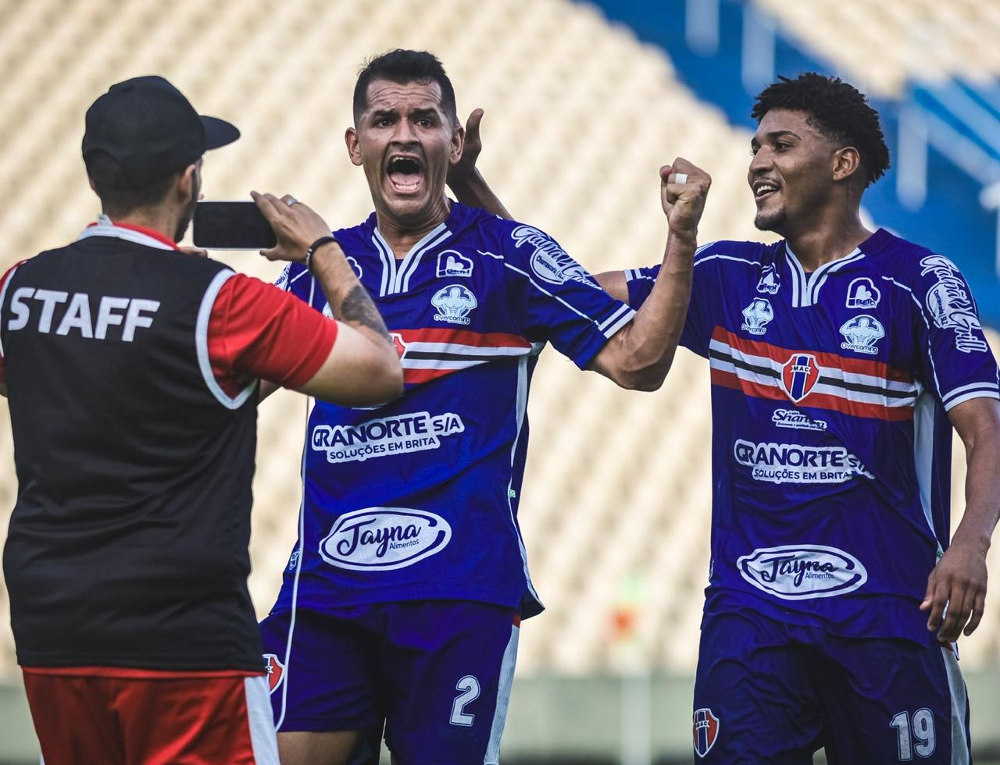

O Maranhão Atlético anuncia o retorno do lateral direito Igor Nunes para a temporada 2027. 

O defensor de 29 anos retorna ao bode onde foi campeão maranhense e conquistou o acesso a Série C do Brasileirão no ano de 2025 com 31 jogos e 1 gol. O atleta atuou pelo Serra Branca-PB na última temporada.

