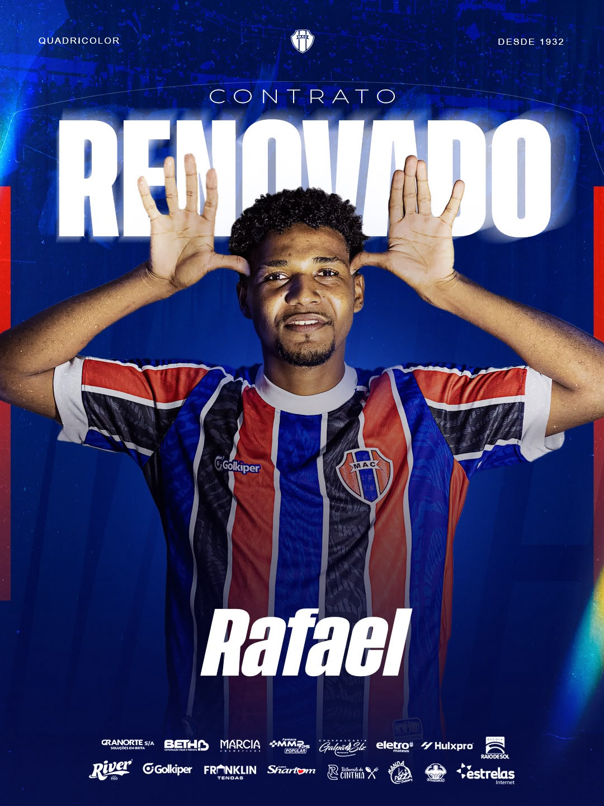

O Maranhão Atlético anuncia as renovações de contrato dos atletas Lucas Santos, Rafael e Negueba para a temporada 2027.

Lucas Santos de 29 anos chegou ao clube em 2026, disputou 22 jogos pelo Quadricolor. 

Desde 2022 no clube, o atacante Rafael renova por mais uma temporada com o Maranhão. Em 2026, o atacante disputou 29 jogos com a camisa Quadricolor. 

O Lateral direito Negueba continuará no clube, onde disputou 4 jogos na temporada 2026. Negueba enfrentou uma lesão séria nesta temporada e já está em recuperação no clube para voltar 100% em 2027. 

