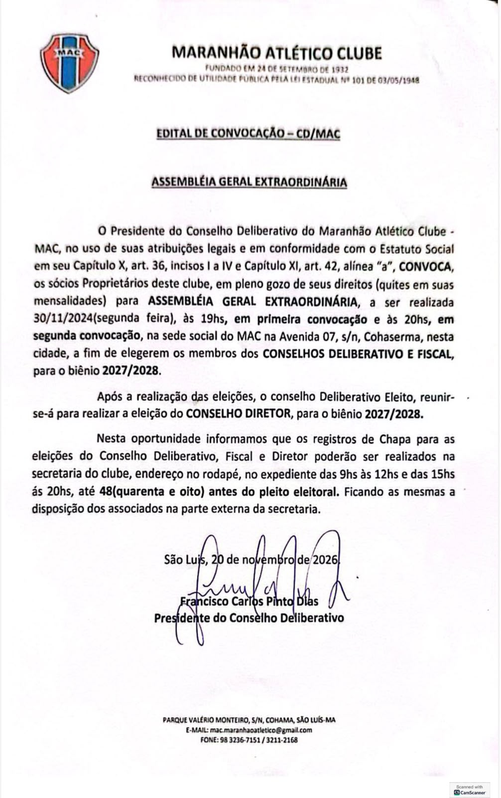
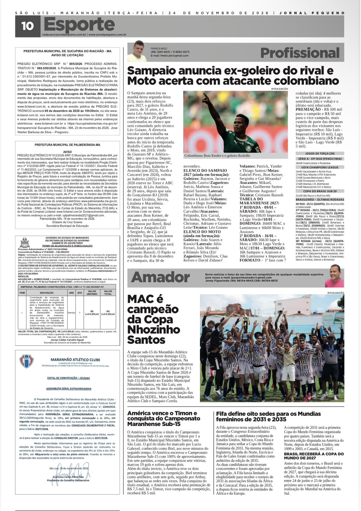

O Presidente do Conselho Deliberativo do Maranhão Atlético Clube - MAC, no uso de suas atribuições legais e em conformidade com o Estatuto Social em seu Capítulo X, art. 36, incisos | a IV e Capítulo XI, art. 42, alínea “a\*, CONVOCA, os sócios Proprietários deste clube, em pleno gozo de seus direitos (quites em suas mensalidades) para ASSEMBLÉIA GERAL EXTRAORDINÁRIA, a ser realizada 30/11/2024(segunda feira), às 19hs, em primeira convocação e às 20hs, em segunda convocação, na sede social do MAC na Avenida 07, s/n, Cohaserma, nesta cidade, a fim de elegerem os membros dos CONSELHOS DELIBERATIVO E FISCAL, para o biênio 2027/2028.

Após a realização das eleições, o conselho Deliberativo Eleito, reunir-se-á para realizar a eleição do CONSELHO DIRETOR, para o biênio 2027/2028.

Nesta oportunidade informamos que os registros de Chapa para as eleições do Conselho Deliberativo, Fiscal e Diretor poderão ser realizados na secretaria do clube, endereço no rodapé, no expediente das 9hs às 12hs e das 15hs ás 20hs, até 48 (quarenta e oito) antes do pleito eleitoral. 

Ficando as mesmas a disposição dos associados na parte externa da secretaria.

São Luís, 20 de novembro de 2026. 

Francisco Carlos Pinto Dias

Presidente do Conselho Deliberativo

