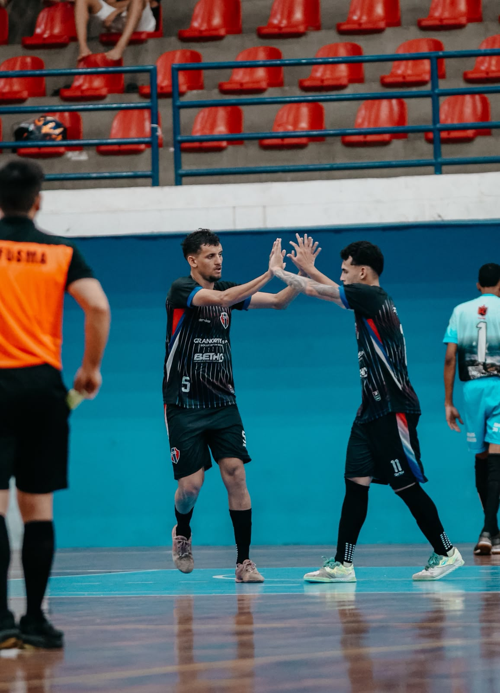

Na estreia da Copa Alim Maluf Futsal, o Maranhão Atlético Clube mostrou sua força nas quadras e venceu a equipe do IBP Paraguay pelo placar de 5 a 1, marcando um retorno em grande estilo ao futsal!

A partida foi realizada na noite deste sábado (21) no Ginásio Costa Rodrigues, dando inicio a primeira rodada da Copa Alim Maluf de Futsal 2026.

