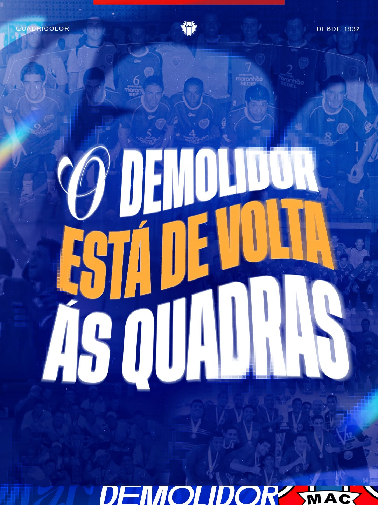

O Maranhão Atlético Clube está de volta ao futsal.

Uma nova história começa a ser escrita, levando as quatro cores e a tradição do Maranhão Atlético Clube de volta para o futsal em 2026, ano que se comemora 30 anos do primeiro título maranhense da categoria, em virada histórica contra o Girassol. 

Fiquem ligados, porque em breve teremos muitas novidades.

