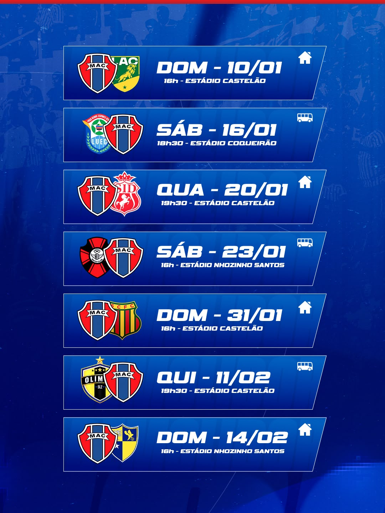

Na noite desta sexta feira (20) foi lançado oficialmente o Campeonato Maranhense 2027 pela Federação Maranhense de Futebol, em evento realizado na Associação dos Magistrados.

O Quadricolor tera como seu primeiro desafio o Luminense, dia 10 de janeiro no estádio Castelão as 16 horas.

Confira na arte seguinte os 7 confrontos do Maranhão Atlético no estadual em 2027.

